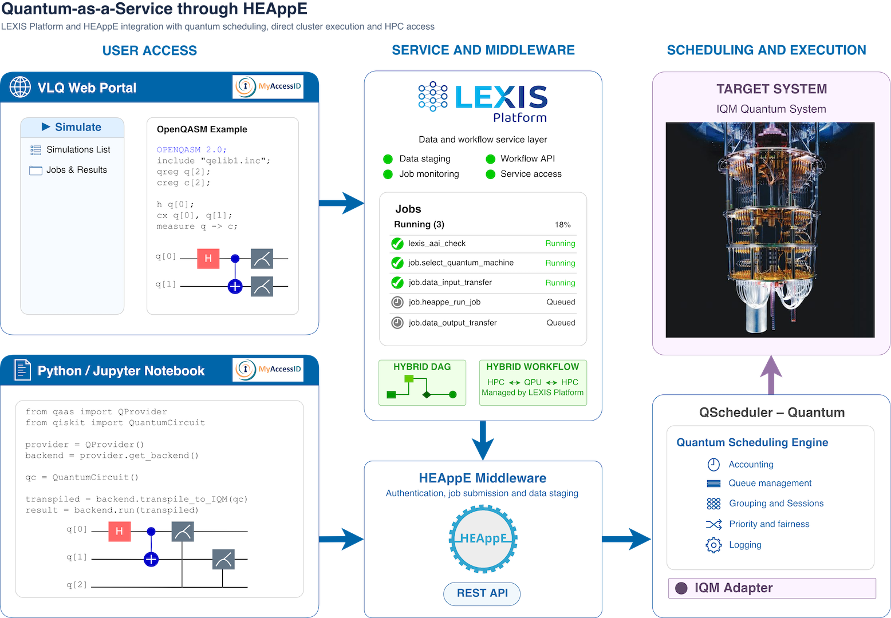

QHEAppE — Quantum-as-a-Service through HEAppE
==============================================

|version| |python| |docs|

.. |version| image:: https://img.shields.io/pypi/v/qaas
   :target: https://pypi.org/project/qaas/
   :alt: PyPI version
.. |python| image:: https://img.shields.io/pypi/pyversions/qaas
   :target: https://pypi.org/project/qaas/
   :alt: Python versions
.. |docs| image:: https://img.shields.io/badge/docs-GitHub%20Pages-blue
   :target: https://it4innovations.github.io/quantum-as-a-service/
   :alt: Documentation

Access IQM quantum hardware through the `LEXIS Platform <https://docs.lexis.tech/>`_ via `HEAppE <https://heappe.eu/>`_.

**Documentation:** https://it4innovations.github.io/quantum-as-a-service/

Requirements
------------

- Python 3.12
- Required Python packages: see `dependencies` in `pyproject.toml <pyproject.toml>`_
- Server side: HEAppE and QScheduler, see `Compatibility`_

Compatibility
-------------

Install **one** IQM extra:

.. list-table::
   :header-rows: 1

   * - Extra
     - iqm-client
     - Backends (station-control)
     - Used by
   * - ``iqm_qiskit`` (recommended), ``iqm36_qiskit``
     - 36.0
     - 49.x, 50.x
     - QHEAppE Client, pulse-level access (QPulla)
   * - ``iqm35_qiskit``
     - 35.0
     - 49.x
     - legacy ``qaas.client``

Minimum server versions:

.. list-table::
   :header-rows: 1

   * - Feature
     - HEAppE
     - QScheduler
   * - Circuit jobs
     - 6.6+
     - 0.2+
   * - Pulse-level access (QPulla)
     - 6.7.0+
     - 0.2.2+, with pulse access enabled for the machine

Installation
------------

QHEAppE can be installed using pip. To install the package along with optional dependencies for IQM integration:

.. code-block:: bash

   pip install qaas[iqm_qiskit] --extra-index-url https://opencode.it4i.eu/api/v4/projects/107/packages/pypi/simple

For the other extras see `Compatibility`_. ``QProvider.get_backend()`` checks the version
the backend reports and raises an error that names the extra to install if it does not match.

.. note::

   **Pulse-level access (Pulla)**: ``QProvider.get_pulla()`` returns a ``QPulla``, an
   ``iqm.iqm_client.IQMClient`` connected through HEAppE. See the
   `usage documentation <https://it4innovations.github.io/quantum-as-a-service/usage/#pulse-level-access-pulla>`_.

Architecture
-------------

Quick start
-----------

The following example demonstrates the basic usage of the QProvider and QBackend interfaces:

.. code-block:: python

   from qheappe_client.qprovider import QProvider
   from qiskit import QuantumCircuit

   # 1. Build a Qiskit circuit (Bell state)
   qc = QuantumCircuit(2, 3)
   qc.h(0)
   qc.cx(0, 1)
   qc.measure([0, 1], [0, 1])
   qc.h(0)
   qc.measure(0, 2)

   # 2. Instantiate QProvider with your LEXIS authentication details
   lexis_project = "your_project_name"
   resource_name = "your_resource_name"

   provider = QProvider(
       lexis_project=lexis_project,
       # Without passing token, an interactive login flow through the browser will happen
       # token=os.getenv("LEXIS_TOKEN"),
   )

   # Alternatively, you can log in via py4lexis and then pass the session (recommended for remote scripts executed on remote HW via terminal, etc.)
   # from py4lexis.session import LexisSession
   # session = LexisSession()  # Interactive login flow
   # token = session.get_access_token()

   # 3. Initialize the QBackend with the client
   backend = provider.get_backend(
       lexis_resource=resource_name, backend_name="target_backend_name"
   )

   # 4. Transpile the circuit
   qc_transpiled = backend.transpile(qc)

   # 5. Submit the circuit job
   job = backend.run(qc_transpiled, shots=1024, job_name="demo_bell_state")
   print(f"Job submitted successfully. Job ID: {job.job_id()}")

   # 6. Retrieve results
   result_legacy = job.result(qiskit_legacy=True, with_measurements=True)
   counts_legacy = result_legacy.get_counts()
   bitstring_legacy = result_legacy.get_memory()

   result = job.result(with_measurements=True)
   counts = result[0].data.meas.get_counts()
   bitstrings = result[0].data.meas.get_bitstrings()

   print("Legacy Execution Results:")
   print("Counts:", counts_legacy)
   print(f"Bitstring: {bitstring_legacy!s:.20s}")

   print("Primitive Execution Results:")
   print("Counts:", counts)
   print(f"Bitstring: {bitstrings!s:.20s}")

``job.result()`` returns a Qiskit ``PrimitiveResult`` by default, or a legacy ``Result``
with ``qiskit_legacy=True``. The difference is explained in
`PrimitiveResult vs. legacy Result <https://it4innovations.github.io/quantum-as-a-service/usage/#primitiveresult-vs-legacy-result>`_.

How to Fetch Calibration Data
------------------------------

Use the client to retrieve a calibration set by its UUID. To retrieve the
default calibration set, pass ``None`` instead.

.. code-block:: python

   from uuid import UUID
   from qheappe_client.qprovider import QProvider

   provider = QProvider("your_project_name")
   calibration_set = provider.get_backend(
       lexis_resource="your_resource_name",
       calibration_set_id=UUID("3a83e2f3-c5a8-43b7-9aa1-e9738ca3204b")
   ).get_backend_info().calibration_set_id

Authors
-------

- Jan Swiatkowski (jan.swiatkowski@vsb.cz)
- Jakub Konvička (jakub.konvicka@vsb.cz)
- Jan Martinovič (jan.martinovic@vsb.cz)
- Ladislav Foltyn (ladislav.foltyn@vsb.cz)

License
-------

Apache 2.0 — see ``LICENSE``.