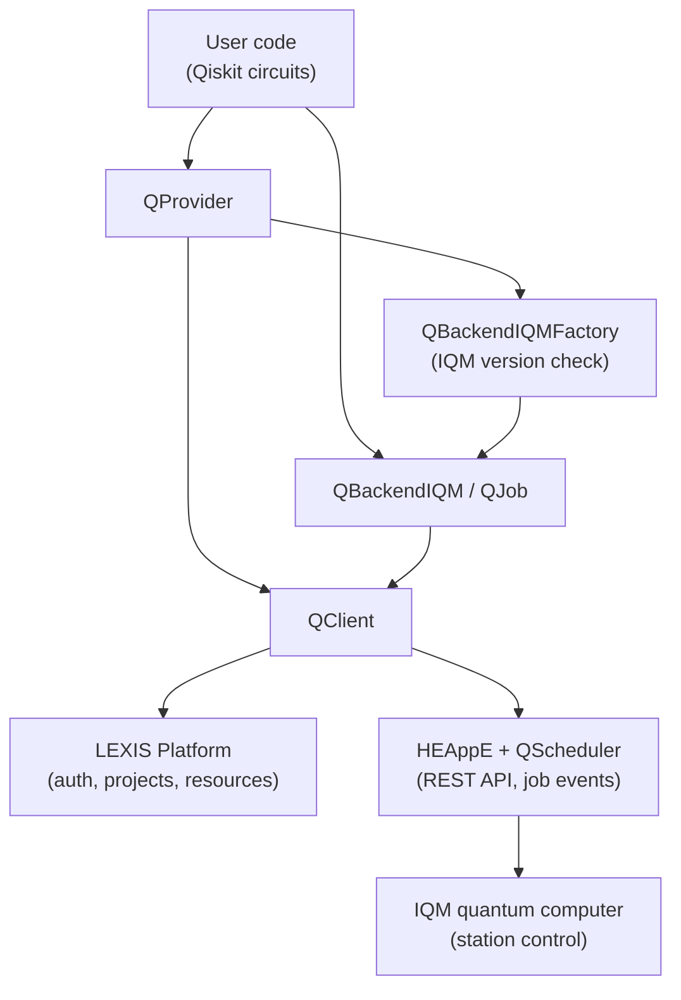

# Architecture

The QHEAppE Client is the user-side part of the QaaS solution. It talks to two services:

- **LEXIS Platform** — authentication, projects and quantum resources (which HEAppE instances and backends you may use)
- **HEAppE with QScheduler** — the REST API in front of each quantum computer: machine information, calibration, job submission, results and job events

## Components

### `QProvider`

The entry point. Takes a LEXIS project and token, creates one `QClient` per quantum resource (cached), and builds backends through `QBackendIQMFactory`.

### `QClient`

Does all network communication, asynchronously (`aiohttp`), with a synchronous API on top. Sync calls run on the client's own background event loop, so they also work inside Jupyter and other code that already runs an event loop.

- verifies the LEXIS token and checks access to the project and resource
- discovers the HEAppE clusters (backends) of the resource and checks their availability
- reads `MachineInfo`, the machine architecture and calibration data from QScheduler
- submits jobs, fetches results and artifacts, cancels jobs, and manages QScheduler sessions
- listens to the HEAppE job-event websocket to know when a job finishes

### `QBackendIQM` and `QJob`

A Qiskit `BackendV2` built from the backend's IQM dynamic architecture. It transpiles circuits with IQM's transpiler, serializes them into an IQM circuit job definition and submits it through `QClient`. `QJob` waits for the job and converts the results into a Qiskit `PrimitiveResult` or legacy `Result`.

### `QBackendIQMFactory` (IQM version selection)

Only one generation of the IQM client libraries can be installed at a time (`iqm_qiskit` = iqm-client 36, `iqm35_qiskit` = iqm-client 35). The factory compares the installed one with the `station_control_version` the backend reports in `MachineInfo`:

| Backend station-control | Works with |
|-------------------------|------------|
| 50.x (current) | iqm-client 36 |
| 49.x (older) | iqm-client 36 (recommended) or iqm-client 35 |
| unknown | the installed version, with a warning |

On a mismatch it raises a `QException` with the `pip install` command for the right extra. The differences between the IQM versions are kept in small adapter modules (`qheappe_client.iqm_compat.iqm35` / `iqm36`).

## Job flow

What happens when you call `backend.run(...)` and `job.result()`:

1. **Job definition** — the transpiled circuits are converted into an IQM circuit job definition (JSON), including the calibration set and shot count.
2. **Submission** — `QClient` sends it to `POST /heappe/QScheduler/CreateAndSubmitJob`; HEAppE returns the job ID.
3. **Execution** — QScheduler queues the job and runs it on the IQM quantum computer.
4. **Completion** — `QClient` waits for a terminal job state from the HEAppE event websocket (`/heappe/Events`).
5. **Results** — the results of each task are fetched from `GET /heappe/QScheduler/GetTaskResult` (and per-shot measurements as task artifacts) and converted into Qiskit result objects.

## Design decisions

- **Client-side transpilation** — circuits are transpiled against the backend's current calibration before submission, so the backend always receives native-gate circuits.
- **Current calibration** — the dynamic architecture is loaded when the backend is created; `calibration_set_id` pins a specific one, and `use_metrics=True` adds calibration quality metrics to the transpiler target.
- **Direct QScheduler API** — jobs are submitted through the QScheduler REST API instead of HEAppE command templates (used by the legacy `qaas` client).
- **Optional IQM dependencies** — the IQM libraries come from extras, so the client can support more than one IQM release.
